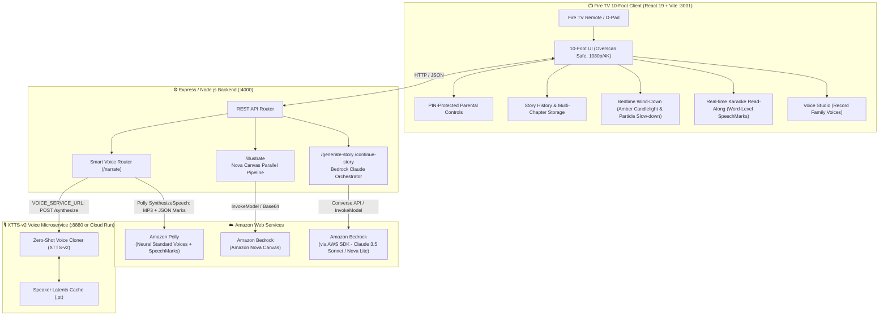

# Family Story Night 📺✨

> **Build, Ship, Shape: Amazon Developer Hackathon**  
> **Tracks**: 📺 **Fire TV Track** & ☁️ **AWS Builder Mini Challenge**  
> **Collaborator Access**: Shared with `@AmazonAppDev` and `testing@devpost.com` for judging.

---

## 🌟 Vision: Reimagining Bedtime for the Living Room

Most TV apps are passive video players or high-stimulation dopamine loops. **Family Story Night** transforms the living room Fire TV into a magical, interactive bedtime hearth.

Parents and children co-create personalized bedtime adventures starring their own family members, choose beloved themes (from enchanted forests to biblical tales), watch scenes illustrated live with **Amazon Bedrock**, listen to expressive narration with **Amazon Polly** or **their own cloned family voices via XTTS-v2**, and follow along with **real-time Karaōke word highlighting** that encourages early childhood literacy. As the story draws to a close, **Bedtime Wind-Down Mode** automatically shifts the screen into warm candlelight amber and slows the ambient stardust, gently easing children into sleep.

---

## 🏗️ System Architecture



---

## 📖 How to Use the App: Feature Walkthrough

### 1. 🧙 Story Setup & Cast Customization
- **Family Cast Members**: Enter the names of family members (e.g., Leo, Maya, Mommy). Use the on-screen keyboard or press the **Voice Input** button on the Fire TV remote to dictate names directly.
- **Bedtime Themes**: Cycle through enchanting themes using D-pad Left/Right — from *Bedtime Adventure*, *Enchanted Forest*, and *Space Voyage* to *Bible Stories* and *Gentle Underwater Tales*.
- **Reading Length**: Choose between *Quick (3 pages)*, *Standard (5 pages)*, or *Extended (7 pages)* to align with your bedtime routine.

### 2. 🎙️ Voice Studio: Cloning Family Voices
- Navigate to **Voice Studio** on the main menu.
- **Record Reference Audio**: Parents or grandparents record a short 10-second bedtime phrase (e.g., *"Close your eyes, take a deep breath, and let's go on a magical bedtime adventure together."*).
- **Instant Latent Extraction**: The voice service extracts speaker conditioning latents (`gpt_cond_latent` and `speaker_embedding`) and caches them permanently to disk (`.pt`).
- **Select for Storytime**: In the story setup screen, choose your custom cloned voice from the voice dropdown. When selected, the story is narrated in Mom, Dad, or Grandma's voice with matching Karaōke highlighting!

### 3. 📖 Bedtime Reading & Real-Time Karaōke
- **Synchronized Read-Along**: As each word is spoken, it illuminates in gold on the big screen, reinforcing word recognition and early childhood literacy.
- **Cinematic Visuals**: Each page displays high-resolution storybook art generated dynamically by **Amazon Nova Canvas** with smooth Ken Burns camera panning.
- **Instant Playback & Background Prefetching**: Narration begins immediately without blocking on background illustration rendering. While the child listens to page $N$, the client automatically prefetches narration for page $N+1$ in the background for zero-latency page turns.
- **Visual Voice Status**: Dedicated on-screen status shows when the engine is actively reading aloud or preparing a custom voice clone.
- **Audio & Page Controls**:
  - Press **D-Pad Right / Left** to advance or review pages.
  - Press **Play / Pause** on the Fire TV remote to toggle narration.

### 4. 🔀 Branching Multi-Chapter Adventures
- At the end of each chapter, the story presents **3 bedtime-friendly adventure choices** (e.g., *"Investigate the whispering tree"*, *"Follow the glowing fireflies"*, or *"Rest by the babbling brook"*).
- Pick an option using the remote D-pad, and **Amazon Bedrock (Claude 3.5 Sonnet)** generates the next chapter while maintaining character continuity and introducing a new bedtime moral.

### 5. 🌙 Bedtime Wind-Down Routine
- Automatically triggers on the final page or can be scheduled in Parental Settings.
- Shifts screen color temperature to soothing candlelight amber (`#E8A33D`, `#D97724`), slows floating particle motion by 50%, activates a screen dimming veil, and plays a peaceful lullaby chime to help children drift off to sleep.

### 6. 🔒 PIN-Protected Parental Controls
- Access via the **Parental Settings** gear icon (default PIN: `1234`).
- Configure bedtime schedules, restrict themes, enforce maximum reading duration, and set a custom parental PIN.

---

## 🛠️ Services Breakdown

### 1. Web Client (`client/`)
- **Framework**: React 19 + Vite (built for 10-foot TV interfaces, 1080p and 4K displays).
- **Navigation**: Full remote D-pad controller mapping (`ArrowUp`, `ArrowDown`, `ArrowLeft`, `ArrowRight`, `Enter`, `Escape`, `MediaPlayPause`).
- **Port**: `3001` (dev server).

### 2. Backend Orchestrator (`server/`)
- **Framework**: Node.js & Express.
- **Responsibilities**:
  - Calls **Amazon Bedrock** (via AWS SDK - Claude 3.5 Sonnet) for story creation and chapter continuation.
  - Calls **Amazon Nova Canvas** for parallel page illustration generation.
  - Routes voice synthesis: calls **Amazon Polly** for standard neural voices, or routes custom family voices to the **Voice Microservice** via `VOICE_SERVICE_URL`.
- **Port**: `4000`.

### 3. Voice Cloning Microservice (`voice-service/`)
- **Framework**: Python 3.10 / FastAPI + Coqui XTTS-v2.
- **Features**:
  - True zero-shot voice cloning from a 10-second reference audio sample.
  - Pre-computed speaker conditioning latents (`.pt`) and in-memory synchronization cache to bypass repeated audio encoding and heavy network transfers.
  - Acoustic waveform energy envelope detection and punctuation pause modeling (480ms for periods, 260ms for commas) for millisecond Karaōke speech marks.
  - Flexible deployment profiles:
    - **Google Cloud Run (NVIDIA L4 GPU)**: Serverless, scale-to-zero, ~350–450ms inference.
    - **Google Colab (NVIDIA T4 GPU)**: Free zero-setup runner with Cloudflare tunnel (`colab_voice_service.ipynb`).
    - **Amazon ECS on EC2 `g4dn.xlarge`**: Single-cloud AWS production hosting with NVIDIA T4 GPU.
- **Port**: `8880`.

---

## 🎮 Fire TV Remote Navigation Guide

| Remote Button | Key Code | Action in Family Story Night |
| :--- | :--- | :--- |
| **D-Pad Up / Down** | `ArrowUp` / `ArrowDown` | Navigate between settings, inputs, and adventure choice cards |
| **D-Pad Left / Right** | `ArrowLeft` / `ArrowRight` | Turn story pages, cycle theme carousels |
| **Select (Center Button)** | `Enter` / `Space` | Confirm selection, choose next adventure branch |
| **Back Button** | `Escape` / `BrowserBack` | Return to story setup or previous menu |
| **Play / Pause** | `MediaPlayPause` | Pause / resume aloud story narration |
| **Number Keys (0-9)** | `Digit0` – `Digit9` | Quick PIN entry for parental controls |

---

## 🚀 Quick Start: Running Everything Locally

### Prerequisites
- **Node.js 18+** and **npm**
- **Python 3.10+**
- **AWS Account** with Bedrock model access (Claude 3.5 Sonnet & Nova Canvas) and Amazon Polly enabled

### Step 1: Clone the Repository
```bash
git clone https://github.com/adSesugh/family-story-night-firetv.git
cd family-story-night
```

### Step 2: Configure Environment Variables
Create `server/.env`:
```env
AWS_ACCESS_KEY_ID=your_aws_access_key
AWS_SECRET_ACCESS_KEY=your_aws_secret_key
AWS_REGION=us-east-1
BEDROCK_MODEL_ID=amazon.nova-pro-v1:0
BEDROCK_IMAGE_MODEL_ID=stability.stable-image-core-v1:1
BEDROCK_IMAGE_REGION=us-west-2
POLLY_ENGINE=standard
PORT=4000
VOICE_SERVICE_URL=http://localhost:8880
```

### Step 3: Start the Voice Cloning Microservice
You can run the voice microservice locally, or connect to a free GPU runner in Google Colab:

**Option A: Free Google Colab T4 GPU (Recommended for Testing & Judging)**:
1. Open [`voice-service/colab_voice_service.ipynb`](file:///Users/adsesugh/devapps/family-story-night/voice-service/colab_voice_service.ipynb) in Google Colab.
2. Select **Runtime > Change runtime type > T4 GPU**.
3. Run all cells in order. The notebook downloads XTTS-v2 and starts a public HTTPS Cloudflare tunnel.
4. Set the printed URL in `server/.env`:
   ```properties
   VOICE_SERVICE_URL=https://your-tunnel-url.trycloudflare.com
   ```

**Option B: Local Machine Execution**:
```bash
cd voice-service
python3 -m venv .venv_xtts
source .venv_xtts/bin/activate
pip install -r requirements.txt
python app.py
```
*The voice service will start on `http://localhost:8880`.*

### Step 4: Start the Backend Server
In a new terminal:
```bash
cd server
npm install
npm run dev
```
*The Express server will start on `http://localhost:4000`.*

### Step 5: Start the Fire TV Web Client
In a new terminal:
```bash
cd client
npm install
npm run dev
```
*Open `http://localhost:3001` in your browser or Fire TV Web App Tester.*

---

## ☁️ Deploying the Voice Service: Architecture & Options

The voice cloning microservice is designed for fast, zero-shot autoregressive inference. We offer multiple deployment patterns depending on your infrastructure preferences:

### Option 1: Free Google Colab Runner (Zero-Cost Hackathon Judging)
Run [`voice-service/colab_voice_service.ipynb`](file:///Users/adsesugh/devapps/family-story-night/voice-service/colab_voice_service.ipynb) on a free Colab NVIDIA T4 GPU instance. It patches all dependencies, starts the FastAPI microservice, and launches a secure public Cloudflare HTTPS tunnel with zero configuration.

### Option 2: Google Cloud Run with NVIDIA L4 GPU (Production Serverless)
For production-grade voice cloning with **instant ~350–450ms inference**, deploy to Google Cloud Run with an NVIDIA L4 GPU:
```bash
cd voice-service
chmod +x deploy-cloudrun.sh
./deploy-cloudrun.sh
```
- **Scale-to-Zero**: Scales down to 0 instances when idle, incurring $0 baseline cost.
- **Container Cold-Start**: Pre-cached checkpoint layers in the Docker image enable fast boots (<3s).

### Option 3: Native AWS Hosting (Amazon ECS on EC2 `g4dn.xlarge`)
To maintain all application tiers within a single AWS cloud perimeter alongside Amazon Bedrock and Amazon Polly:
- Deploy [`voice-service/Dockerfile`](file:///Users/adsesugh/devapps/family-story-night/voice-service/Dockerfile) to **Amazon ECS** backed by an EC2 `g4dn.xlarge` instance (NVIDIA T4 Tensor Core GPU, 16 GB RAM).
- Provides dedicated sub-second synthesis (~500ms per page) within your AWS VPC.

> [!NOTE]
> **Why Not AWS Lambda for XTTS-v2?**
> AWS Lambda runs exclusively on CPUs and does not provide GPU acceleration. Autoregressive transformer synthesis for XTTS-v2 on CPU takes **25–45 seconds per page**, which exceeds Amazon API Gateway's hard **29-second timeout ceiling** (triggering `504 Gateway Timeout` errors) and creates a sluggish bedtime experience. Dedicated GPU hosting or serverless L4 GPU containers are therefore strongly recommended for deep-learning voice cloning.

---

## 📦 Fire TV Packaging & Testing

To package the client for Fire TV:
```bash
npm run package
# Produces client/family-story-night.zip ready for Amazon Web App Tester
```

1. Install **Amazon Web App Tester** on your Fire TV Stick / Fire TV Cube from the Amazon Appstore.
2. Enter your hosted URL (or sideload `client/family-story-night.zip`).
3. Verify remote D-pad navigation, audio narration, and full-screen 10-foot display rendering.

---

## 🧪 Automated Test Suite

Run the full end-to-end test suite across client and server:

```bash
# Run all tests (frontend + backend)
npm test

# Run frontend tests (React components, D-pad navigation, Wind-Down, Karaoke)
cd client && npm test

# Run backend tests (Bedrock orchestrator, Polly synthesis, Voice microservice routing)
cd server && npm test
```

*252 automated tests (171 client tests across 30 test suites + 81 backend tests across 9 test files) verifying remote keycodes, audio synthesis, bedtime dimming, and voice cloning.*

---

## 🔒 Private Repository Access for Judges

As permitted by hackathon guidelines, this repository has been shared with the official judging accounts:
- `@AmazonAppDev` (GitHub)
- `testing@devpost.com` (Devpost review team)

---

*Built with ❤️ for families everywhere during the Amazon Developer Hackathon.*